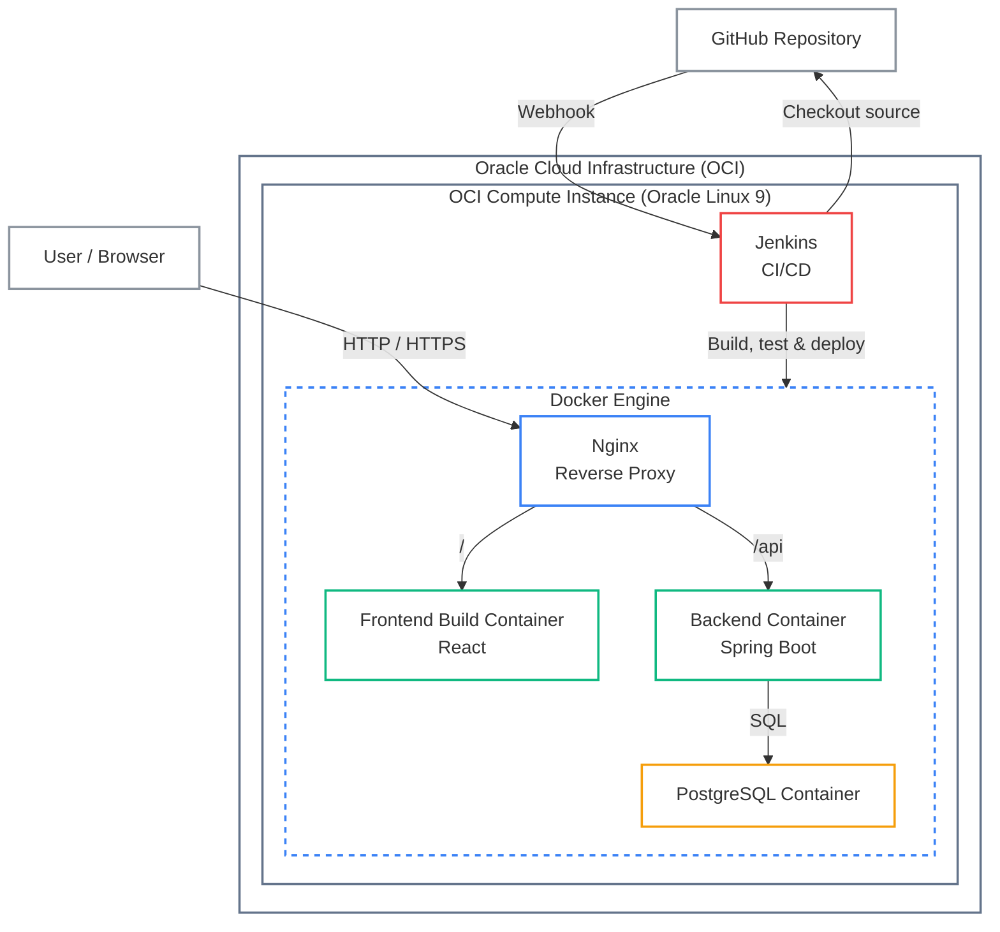
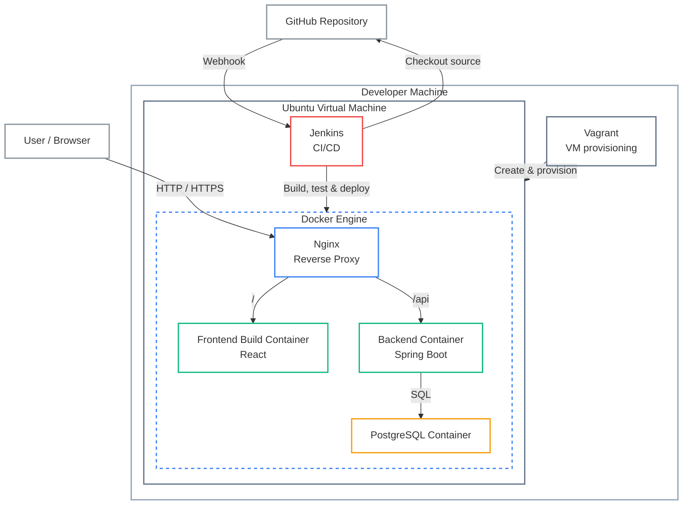

# Infrastructure & Deployment Guide

This document outlines the deployment workflow and infrastructure setup for the Dynamic Rent Adjustment System (DRAS).

## 1. Architecture Diagrams

### Diagram A: Production Deployment Architecture (OCI)



### Diagram B: Local Deployment / Reproducible Environment (Vagrant)



## 2. Prerequisites

### Local Development (Docker only)
- Docker and Docker Compose
- Git

### Local VM (Vagrant)
- Vagrant
- Hypervisor: `libvirt` with `vagrant-libvirt` plugin (default in `Vagrantfile`), or VirtualBox
- Git

## 3. Local Development (Docker)

The application is containerized using Docker and orchestrated with Docker Compose.
Nginx acts as a reverse proxy, routing traffic to the frontend and backend containers.
- **Start everything:** Run `docker compose up -d`.
- **Rebuild (backend / dependency changes):** Run `docker compose up -d --build`.
- **Rebuild (frontend changes):** The React build is served from a named Docker volume (`frontend_dist`),
  which Docker only populates from the baked-in image contents when the volume is first created. To remove the containers, run:
  ```bash
  docker compose down
  docker volume rm dynamic-rent-adjustment-system_frontend_dist
  docker compose up -d --build
  ```
  *(Alternatively, to keep `db` and `backend` running: `docker compose rm -f -s nginx frontend && docker volume rm dynamic-rent-adjustment-system_frontend_dist && docker compose up -d --build frontend nginx`)*
  > **Note:** This only applies to the local Docker environment. When running via **Vagrant** or a VM, frontend rebuilds and volume clearing are handled automatically by the Jenkins pipeline's Deploy stage. Trigger a build by clicking **Build Now** in Jenkins.
- **Reset database (wipe all data):**
  > [!CAUTION]
  > The following actions permanently delete all database data:
  >
  > - `docker compose down -v` removes all named volumes (both the database and frontend build, so the next `docker compose up -d` will take longer).
  > - **Local Docker Environment:**
  >   ```bash
  >   docker compose down
  >   docker volume rm dynamic-rent-adjustment-system_db_data
  >   docker compose up -d
  >   ```
  > - **Vagrant Environment:**
  >   Inside the VM, Jenkins deploys containers under the project name `dras`. To stop the containers and remove the volume, specify `-p dras`:
  >   ```bash
  >   cd /var/lib/jenkins/workspace/dras-dev
  >   sudo docker compose -p dras down
  >   sudo docker volume rm dras_db_data
  >   sudo docker compose -p dras up -d
  >   ```
  > - **Production Environment (OCI VM):**
  >   ```bash
  >   cd /opt/dras/repository
  >   sudo docker compose -f docker-compose.prod.yml down
  >   sudo docker volume rm dras_db_data_prod
  >   sudo docker compose -f docker-compose.prod.yml up -d
  >   ```
- **Stop everything:** Run `docker compose down`.
- **Watch logs:** Run `docker compose logs -f` to see everything, or `docker compose logs -f backend` for just the backend.
- **Access the app:** Navigate to `http://localhost` (the app is served via the Nginx reverse proxy on port 80).

## 4. Infrastructure Provisioning (Vagrant)

Local virtual machine infrastructure is provisioned using Vagrant. The `Vagrantfile` and `bootstrap.sh` automate installing Docker,
Docker Compose, and Jenkins inside an Ubuntu 24.04 VM.

`vagrant up` provisions the VM environment and starts Jenkins, but does not deploy the DRAS application containers directly. Deployment is executed via the Jenkins pipeline.

### Steps to Run Vagrant Environment

1. **Host Setup:** Install Vagrant and `libvirt` (with the `vagrant-libvirt` plugin). If using VirtualBox, change the provider block in `Vagrantfile` from `libvirt` to `virtualbox`.
2. **Start the VM:**
   ```bash
   cd infrastructure/vagrant
   vagrant up
   ```
3. **Jenkins Setup:**
   - Open `http://localhost:8888` on your host.
   - Retrieve the initial admin password:
     ```bash
     vagrant ssh -c "sudo cat /var/lib/jenkins/secrets/initialAdminPassword"
     ```
   - Complete the setup wizard and install suggested plugins.
4. **Configure Credentials:** In Jenkins (**Manage Jenkins > Credentials > System > Global credentials**), add the three `Secret text` credentials required by `Jenkinsfile`:
   - `dras-database-password`
   - `dras-mail-username`
   - `dras-mail-password`
5. **Deploy Application:**
   - Create a new Pipeline job named `dras-dev`.
   - Set **Definition** to **Pipeline script from SCM**, choose **Git**, specify your repository URL, and set **Script Path** to `Jenkinsfile`.
   - Click **Build Now**.
6. **Access Application:** Once the deployment pipeline completes, the application is accessible at `http://localhost:8082` (forwarded to internal Nginx on port 80). Port `8082` is used so that host port `8080` remains available for the production Jenkins SSH tunnel.

### Useful Vagrant Commands
From `infrastructure/vagrant`:
- **See what's running inside Vagrant:** `vagrant ssh -c "docker ps"`
- **Watch live backend logs:** `vagrant ssh -c "docker logs -f dras-backend-1"`
- **Reset database (wipe data & re-initialize):**
  ```bash
  vagrant ssh -c "cd /var/lib/jenkins/workspace/dras-dev && sudo docker compose -p dras down && sudo docker volume rm dras_db_data && sudo docker compose -p dras up -d"
  ```
- **View initial admin password from logs:**
  ```bash
  vagrant ssh -c "sudo docker logs dras-backend-1 2>&1 | grep -A 1 'ADMIN INITIAL PASSWORD'"
  ```
- **SSH into VM:** `vagrant ssh`
- **Stop VM:** `vagrant halt`
- **Destroy VM:** `vagrant destroy`

## 5. CI/CD Pipeline (Jenkins Setup)

Jenkins automatically handles deployments when you push to GitHub. The project includes a `Jenkinsfile` for CI/CD, containing stages for Backend Tests, Frontend Lint, Docker Image Build, Deploy, Smoke Test, and Archive Logs.

### Initial Setup (Local Vagrant Environment)
Follow the step-by-step instructions in [Section 4: Steps to Run Vagrant Environment](#steps-to-run-vagrant-environment).

### Production Setup (OCI)
In production (Oracle Cloud), Jenkins runs as a native system service on the Ubuntu host (not inside Vagrant or Docker). The setup steps are similar, but you access Jenkins via the server's designated port and retrieve the initial password directly from `/var/lib/jenkins/secrets/initialAdminPassword` on the host.

## 6. Production Management (Oracle Cloud VM)

The production configuration (`docker-compose.prod.yml`) includes restart policies, health checks, named volumes, and log rotation, with Nginx being the only publicly exposed service. Before deploying, you must copy `.env.example` to `.env` and edit it with your credentials.

For maintenance operations on the production server, connect via SSH and navigate to `/opt/dras/repository`.
- **See what's running:** Run `docker compose -f docker-compose.prod.yml ps`.
- **Watch live production logs:** Run `docker compose -f docker-compose.prod.yml logs --tail=100 -f`.
- **Manual container redeployment:** To rebuild and restart containers, run `docker compose -f docker-compose.prod.yml build`, followed by `docker compose -f docker-compose.prod.yml down --remove-orphans`, optionally `docker volume rm dras_frontend_dist || true`, and finally `docker compose -f docker-compose.prod.yml up -d`.

## 7. Scheduled Host Maintenance & Cron Jobs (OCI VM)

The Oracle Cloud VM host runs the following automated scheduled tasks (`crontab -l`):

```cron
# 1. Weekly Docker cleanup (Sundays at 03:00)
0 3 * * 0 docker system prune -f >> /home/opc/docker-prune.log 2>&1

# 2. Daily automated database backup (Daily at 03:00)
0 3 * * * /opt/dras/repository/infrastructure/scripts/backup-db.sh >> /opt/dras/backups/backup.log 2>&1

# 3. Weekly ARIMA model retraining & predictions export (Sundays at 22:00)
0 22 * * 0 cd /var/lib/jenkins/workspace/dras-prod/analytics && ./venv/bin/python models/arima_micro.py >> /var/log/dras_arima.log 2>&1
```

- **Manual Backups:** To execute an immediate database backup, run `/opt/dras/repository/infrastructure/scripts/backup-db.sh`. Backups are saved to `/opt/dras/backups/`.

## 8. Troubleshooting

### General Issues
- **Database Connection Issues:** Ensure your `.env` credentials match the Spring Boot configuration. If using Docker, ensure the `db` service is healthy before `backend` starts.
- **Port Conflicts (Local Only):** If port 8080 or 5432 is already in use on your host machine, modify `docker-compose.yml` or the `Vagrantfile` port forwarding settings. In production, port 8080 is never exposed (only port 80 via Nginx).
- **Nginx 502 Bad Gateway:** Check the backend logs (`docker compose logs backend`). This typically occurs if the Spring Boot application fails to start or is still initializing.

### VirtualBox fails to start with Secure Boot enabled (if using VirtualBox)
If `vagrant up` reports that no provider is available or loading the VirtualBox kernel module fails with `Key was rejected by service`, check if the VirtualBox module signing key is enrolled by running `sudo mokutil --test-key /var/lib/shim-signed/mok/MOK.der`.

If it is not enrolled:
1. Run `sudo mokutil --import /var/lib/shim-signed/mok/MOK.der` and choose a temporary password.
2. Reboot, and in the MOK Manager screen, select **Enroll MOK** > **Continue** > **Yes**, enter your password, and **Reboot**.
3. Verify enrollment with the test-key command, load the module with `sudo modprobe vboxdrv`, and start the VM with `vagrant up`.

## 9. Database Connection Ports

To connect a local database client to the different environments, use the following configurations:

- **Local Docker Environment:** Connect to `localhost` on port `5433` (already mapped in `docker-compose.yml`).
- **Local Vagrant Environment:** Connect to `localhost` on port `5434` (forwarded from guest port `5433` in `Vagrantfile`).
- **Production Environment (Remote VM):** First, add `ports: ["127.0.0.1:5432:5432"]` to the `db` service in `docker-compose.prod.yml` to bind it to the server's loopback interface. Then, configure your client to connect to `localhost:5432` using an **SSH Tunnel** through your production server.

## 10. Multi-Environment Concurrent Access Ports

To allow Local, Vagrant, and Production environments to be running and accessible simultaneously without port conflicts, ports are allocated as follows:

| Environment | Component | Host Access URL | Notes |
| :--- | :--- | :--- | :--- |
| **Local (Docker)** | Web App (Nginx) | `http://localhost` (port 80) | `docker-compose.yml` |
| | Backend API | `http://localhost:8081` | Direct backend port |
| | Database | `localhost:5433` | PostgreSQL mapped port |
| **Vagrant (VM)** | Web App (Nginx) | `http://localhost:8082` | Forwarded from guest port 80 |
| | Jenkins CI/CD | `http://localhost:8888` | Forwarded from guest port 8080 |
| | Database | `localhost:5434` | Forwarded from guest port 5433 |
| **Production (OCI)**| Web App (Nginx) | `http://dras.abrdns.com` | Public domain / port 80 |
| | Jenkins CI/CD | `http://localhost:8080` | Via SSH tunnel: `ssh -L 8080:127.0.0.1:8080 dras-oracle` |
| | Database | `localhost:5432` | Via SSH tunnel: `ssh -L 5432:127.0.0.1:5432 dras-oracle` |
